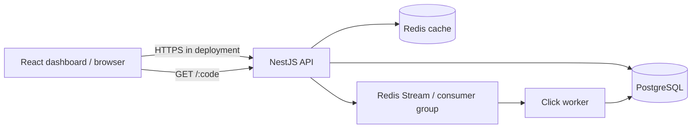

# Shortlink Analytics

A modular URL shortener with a React dashboard, NestJS API, PostgreSQL source of truth, Redis redirect cache, and Redis Streams click worker. The API and worker share one codebase; they are separate processes so click persistence can scale independently.

## Run locally

The repository is organized around two top-level application folders: `backend/` contains the NestJS API, worker, database migrations, deployment guide, and load-test script; `frontend/` contains the React dashboard. Root-level files provide shared Docker, package, and deployment configuration. GitHub Actions workflows stay in the required root `.github/workflows/` directory.

Prerequisites: Docker Compose v2. The root `.env` file contains the local configuration, including the PostgreSQL URL used by the API and migration service. Keep it uncommitted. Start the complete stack with one command:

```sh
docker compose up --build
```

The `.env` file is ignored by Git. Its values are for local development only; set a unique `JWT_SECRET` and production database credentials before deployment.

Open the React dashboard at <http://localhost:4200>, API at <http://localhost:3000>, and Swagger at <http://localhost:3000/api/docs>. Compose starts PostgreSQL and Redis, runs the one-shot `migrate` service, then starts the API and separate click worker after the required health checks pass. The API does not serve until migrations complete. Sequelize synchronization is disabled. PostgreSQL and Redis data use named volumes; only the API and frontend ports are published to the host. The frontend build receives `VITE_API_BASE_URL=http://localhost:3000`, which is the browser-reachable API URL. `docker-compose.yml` is for local development; deployment configuration is separate.

Useful local commands:

```sh
docker compose logs -f api worker migrate
docker compose ps
docker compose down
```

Redis uses AOF with `appendfsync everysec`, a persistent named volume, bounded memory, and `noeviction`. This avoids silently evicting queued click events, but the one-second AOF policy can lose recent writes after a crash, and Redis alone does not guarantee delivery. See [Deployment and limitations](#deployment-and-limitations) for the durability caveat.

## GitHub Actions CI

The workflow at `.github/workflows/ci.yml` is configured for pushes and pull requests. It installs the root and frontend dependencies from their checked-in lockfiles, runs API/worker type checking and build, backend unit tests, PostgreSQL Testcontainers integration tests, frontend lint/type checking/tests/production build, and builds separate API, worker, and frontend Docker images. PostgreSQL integration tests require a runner with Docker; GitHub-hosted `ubuntu-latest` runners provide it.

To connect this local project yourself, create an empty repository in GitHub, then initialize/commit locally if needed and add your repository URL as `origin` before pushing your branch. For example, from the project directory:

```sh
git init -b main
git add .
git commit -m "Add URL shortener application and CI"
git remote add origin https://github.com/<owner>/<repository>.git
git push -u origin main
```

If you already have a local Git repository or commits, skip the corresponding initialization/commit commands. The workflow does not publish images or deploy, so ordinary CI requires no repository secrets or variables. If you later add registry publishing or deployment, configure only the credentials needed for that separate job in GitHub Actions settings; do not add them to source or this workflow.

## Architecture



## API and decisions

- Auth: `POST /api/v1/auth/register`, `/login`, and authenticated `GET /me`. Emails are trimmed and lowercased; passwords must be 12–128 characters and are hashed with Argon2id. Login is limited to 10 failed attempts per IP per 15 minutes by default. API requests never log credentials or request bodies.
- Access JWTs expire after 15 minutes by default. Set `JWT_SECRET` to a random secret of at least 32 characters; the API refuses to start without one. `JWT_ISSUER` and `JWT_AUDIENCE` are checked during verification. Local Docker Compose has a development-only fallback secret; set a unique secret before any deployed use.
- The React frontend stores the access token in `sessionStorage` and sends it as a Bearer token. It clears the token after an authentication failure or logout. JavaScript-accessible storage can be read by injected same-origin scripts, so XSS can expose the token; keep dependencies current, escape rendered content, and apply a restrictive Content Security Policy in deployment. No password is stored. Authentication is stateless: logout clears the browser token, and an issued token remains valid until its 15-minute expiry. There are no refresh tokens or server-side revocation in this version.
- Frontend: React 19 with TypeScript, Vite, and React Router in `frontend/`. Routes cover login, registration, paginated links, link creation, analytics, and not found. The small API client attaches bearer tokens, maps safe error messages, supports abort signals, and never retries a write automatically. The dashboard uses React's text escaping, avoids unsafe HTML insertion, and applies restrictive headers in its local Nginx container. Browser storage remains exposed to same-origin script injection; session storage limits persistence but does not protect against XSS.
- Links: authenticated `POST/GET /api/v1/links`, `GET/DELETE /api/v1/links/:id`; analytics at `/api/v1/links/:id/analytics/{summary,clicks,referrers,devices}`. IDs are UUIDs; owner identity comes from the verified token.
- Redirect: public `GET /:code` returns 302, 404, or 410. Redis cache entries contain only the link ID, destination, and expiry; TTL is capped and bounded by expiry, expiry is rechecked on every redirect, and unknown codes are not cached. Redis cache outages fall back to PostgreSQL. Click capture fails open: enqueue errors are logged and counted at `/health/metrics`, and the redirect proceeds while analytics may lose that event.
- Click delivery uses a Redis Stream and consumer group directly through ioredis. The worker reads bounded batches, claims abandoned pending events, bulk inserts events with unique UUIDs, updates daily totals in the same PostgreSQL transaction, and acknowledges only after commit. Failed batches use a sorted-set retry schedule with exponential backoff and a bounded attempt count; exhausted events go to a dead-letter stream. Persistence is idempotent, but delivery is not guaranteed if Redis loses data or the queue cannot be persisted.
- Cache keys use `shortlink:cache:*`; queue, retry, dead-letter, rate-limit, and metrics keys use distinct `shortlink:queue:*`, `shortlink:rate:*`, and `shortlink:metrics:*` namespaces. `/health/ready` reports PostgreSQL, Redis, and worker heartbeat status; `/health/metrics` exposes cache counters, queue depth components, oldest stream-event age, retries, dropped events, and dead letters.
- Codes use cryptographic random Base62, 8 characters, with a unique index and collision retry. This avoids exposing creation volume and is harder to enumerate than sequential Base62 IDs; sequential codes are shorter at low volume but leak ordering and are more guessable.
- PostgreSQL is authoritative. Indexes cover unique codes, owner-created link listing, click time series, and daily upserts. Deleting a user or link cascades to click events and daily aggregates. Raw click events retain only referrer host and coarse device; user-agent is parsed and discarded. Configure a 90-day click retention job before a long-running deployment; automatic pruning is a next step.
- Sequelize models are registered with NestJS and `synchronize` remains disabled. Schema changes live in `backend/migrations` and are applied explicitly with `npm run db:migrate -w backend` (undo the latest migration with `npm run db:migrate:undo -w backend`).
- List pagination defaults to 20 and caps at 100. Redis link-creation limiting uses a fixed window per account and IP; if Redis is unavailable it logs and fails open, so it is not a distributed guarantee during an outage.
- Destinations are restricted to HTTP(S), reject credentials and private/reserved resolved addresses. Redirect does not fetch the destination; network egress controls are needed before adding previews or scanners.

## Checks and load testing

```sh
npm ci
npm ci --prefix frontend
npm run lint
npm test
npm run build
```

The frontend also supports `npm run dev --prefix frontend` for Vite development and `npm run typecheck --prefix frontend` for a standalone TypeScript check. Its lockfile is `frontend/package-lock.json`.

Run load tests with a pre-created link and k6 installed. First run `BASE_URL=http://localhost:3000 CODE=yourcode VUS=25 DURATION=2m CACHE_MODE=enabled k6 run backend/infra/k6/redirects.js`. Then set `REDIRECT_CACHE_ENABLED=false` in `.env`, restart the API (`docker compose up -d api`), and run the same command with `CACHE_MODE=disabled`. Record each k6 summary and the machine/container limits; no benchmark has been run, so no result is claimed.

| Mode | p95 | Requests/s | Error rate | Cache hit rate | Queue delay/backlog | Duration / VUs / limits |
|---|---:|---:|---:|---:|---:|---|
| Cache enabled | — | — | — | — | — | Not run |
| Cache bypass | — | — | — | — | — | Not run |

## Deployment and limitations

[`render.yaml`](render.yaml) and [the manual deployment guide](backend/docs/deployment-render.md) prepare a Render preview; no provider account, resources, or deployment are configured. Current Render documentation describes Free as suitable for exploration and previews, not production. Free web services sleep after 15 minutes without inbound traffic and take about a minute to wake; free Postgres is limited to 1 GB, expires after 30 days, and has no backups. Free Key Value has 25 MB, 50 connections, and no persistence, so restarts lose queue and cache data. Background workers have no Free plan; the Blueprint uses the smallest paid `0.5c-512mb` worker plan (currently about $7/month). [Render free-plan limits](https://render.com/docs/free), [Key Value limits](https://render.com/docs/key-value), and [current compute prices](https://render.com/pricing) can change. This setup is a short-lived preview, not a fully free or production deployment. Redis uses `noeviction`; when free Key Value reaches its memory limit, queue writes fail rather than evicting events, and the API's fail-open redirect behavior can drop analytics. No live URL or demo credentials have been provisioned.

At 10 million links and 1,000 redirects/s, next steps are managed Postgres connection pooling, Redis capacity sizing, partitioned or expiring click events, cache and queue metrics/alerts, horizontal API/worker scaling, and measured load tests. This starter exposes JSON metrics rather than a Prometheus exporter and has no automated raw-event retention. CI runs PostgreSQL through Testcontainers; the suite needs a working Docker daemon.
